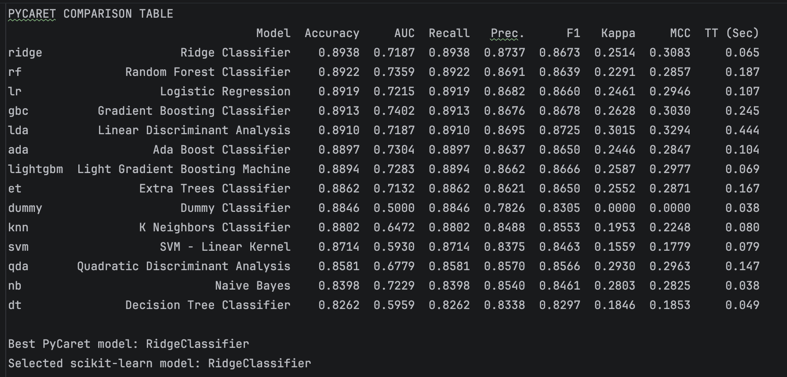
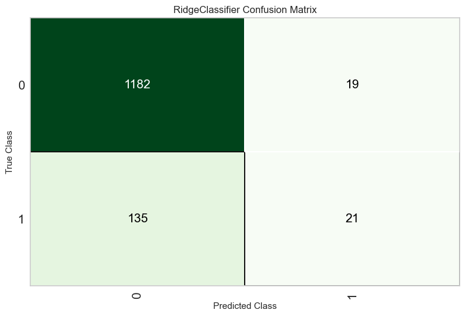
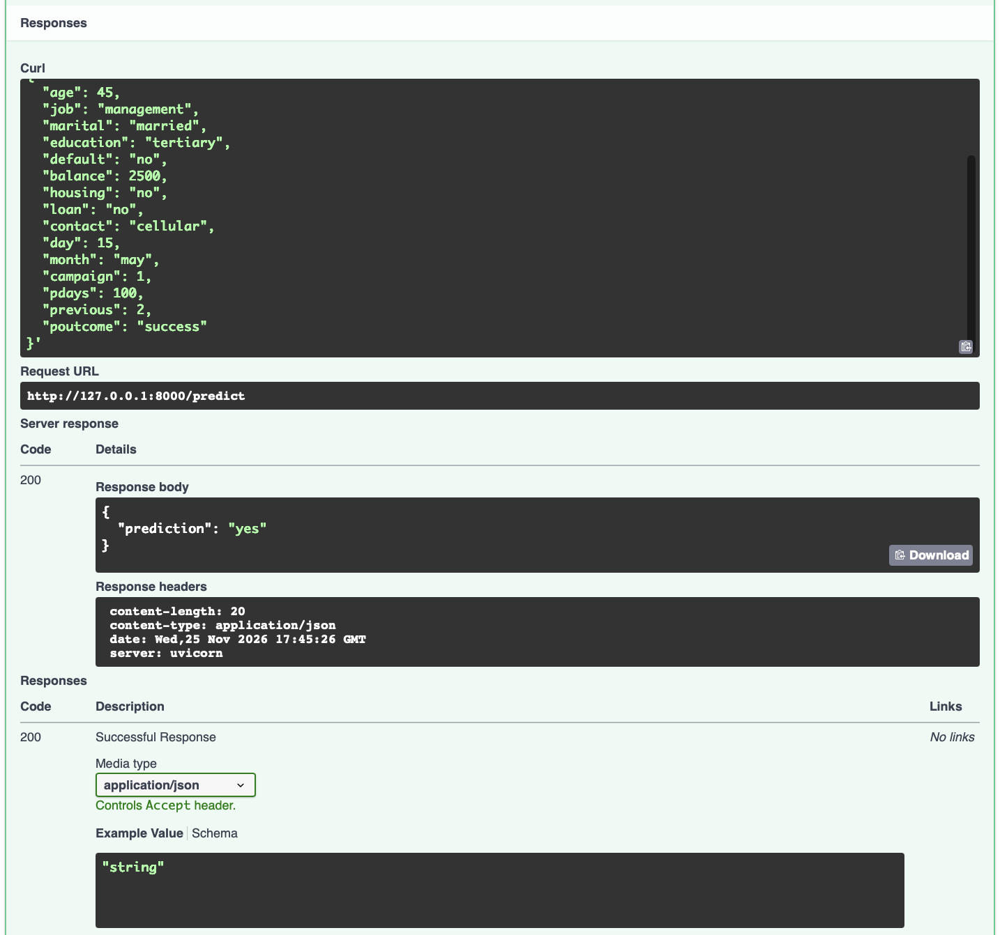
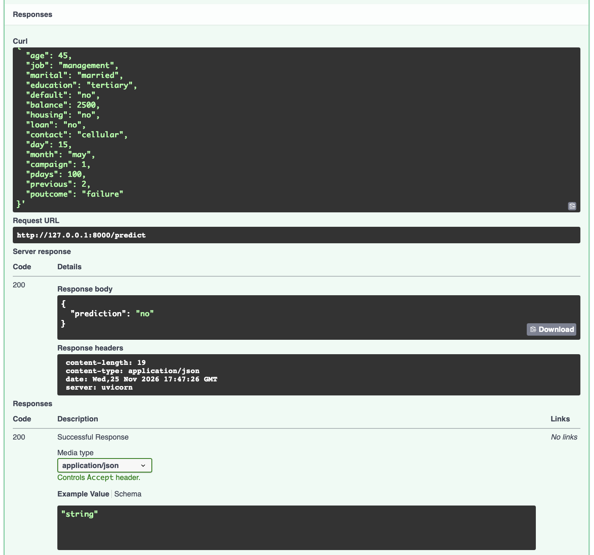

# Automated ML Pipelines & Model Serving

## Business Problem

This project predicts whether a prospective banking customer will subscribe to a term deposit. The objective is to help banks prioritize customers who are more likely to respond positively to marketing campaigns, improving sales efficiency and resource allocation.

## Dataset

Source: [UCI Bank Marketing Dataset](https://archive.ics.uci.edu/dataset/222/bank+marketing)

- Observations: 4,521
- Features: 15
- Target variable: y
- Target classes: yes and no
- Problem type: Binary classification

The dataset includes demographic information, financial characteristics, and previous marketing campaign outcomes.

The prediction is made immediately before a planned marketing call, when the campaign and contact details are already available.

### Dropped Columns

- `duration`: Removed because the length of the current sales call is not known before the call occurs. Including this variable would introduce data leakage and could artificially improve model performance.

The dataset does not contain a dedicated customer ID column.

## How to Run the Project

Python 3.11 and uv are required.

Clone the repository and navigate to the project directory.

For macOS users, install the OpenMP library through Homebrew to support LightGBM:

```bash
brew install libomp
```

Install the project dependencies:

```bash
uv sync
```

Run both machine learning workflows:

```bash
uv run python discovery.py
```

Start the FastAPI application:

```bash
uv run fastapi dev main.py
```

Open the interactive API documentation:

http://127.0.0.1:8000/docs

The prepared dataset is already included in the data folder. To download and prepare the dataset again, run:

```bash
uv run python prepare_data.py
```

## PyCaret Workflow

PyCaret was used to automatically preprocess the dataset, compare classification models using 10-fold cross-validation, and identify the three highest-performing models based on accuracy. A session ID of 42 was used to ensure reproducibility.

### Top Three Models

| Rank | Model | Accuracy |
|---|---|---|
| 1 | Ridge Classifier | 0.8938 |
| 2 | Random Forest Classifier | 0.8922 |
| 3 | Logistic Regression | 0.8919 |

The Ridge Classifier was selected because it achieved the highest cross-validation accuracy of 89.38%.

### Model Comparison



### Confusion Matrix



## Scikit-Learn Workflow

The Ridge Classifier was rebuilt using a manual scikit-learn pipeline.

The dataset was divided into a 70% training set and a 30% testing set using stratified sampling and random_state=42.

A ColumnTransformer was used to apply median imputation and standardization to numeric features, and most-frequent imputation and one-hot encoding to categorical features.

The preprocessing steps and Ridge Classifier were combined into a single Pipeline, allowing the saved model to accept raw customer data.

The fitted pipeline was saved as model.joblib.

### Classification Report

| Class | Precision | Recall | F1 Score | Support |
|---|---|---|---|---|
| No | 0.90 | 0.98 | 0.94 | 1,201 |
| Yes | 0.53 | 0.13 | 0.21 | 156 |
| Weighted Average | 0.85 | 0.89 | 0.86 | 1,357 |

Overall test accuracy: 0.89 (rounded)

## Workflow Comparison

### Results

| Metric | PyCaret | Scikit-learn |
|---|---|---|
| Model | Ridge Classifier | Ridge Classifier |
| Runtime (seconds) | 20.16 | 0.03 |
| Accuracy | 0.8938 | 0.89 |
| Weighted F1 Score | 0.8673 | 0.86 |
| Weighted Precision | 0.8737 | 0.85 |
| Weighted Recall | 0.8938 | 0.89 |

### Efficiency

PyCaret was more efficient in terms of development effort, requiring approximately 16 lines of core modeling code compared with approximately 42 lines for scikit-learn. PyCaret automatically handled preprocessing, model training, and cross-validation, while scikit-learn required these steps to be defined manually. However, scikit-learn was faster in execution, taking only 0.03 seconds compared with PyCaret's 20.16 seconds. This difference is expected because PyCaret compared multiple models across cross-validation folds, whereas scikit-learn trained only the selected model. The recorded PyCaret runtime excludes confusion matrix generation.

### Differences in Model Performance

PyCaret achieved an accuracy of 89.38% and a weighted F1 score of 0.8673, while scikit-learn achieved approximately 89% accuracy and a weighted F1 score of 0.86. These results differ because PyCaret reports average performance across cross-validation folds within the training data, whereas scikit-learn evaluates the model on a single held-out test set. Differences in preprocessing may also contribute to the variation.

### Most Important Business Metric

The positive-class F1 score is the most important metric for this business problem because it balances precision and recall. Despite achieving approximately 89% accuracy, the scikit-learn model identified only 13% of actual subscribers and achieved a positive-class F1 score of 0.21. This demonstrates how accuracy can be misleading when the dataset is imbalanced. A higher positive-class F1 score would help the bank identify more potential customers while limiting resources spent on unsuccessful marketing efforts.

## FastAPI Model Serving

The trained scikit-learn pipeline is loaded once when the FastAPI application starts.

The POST /predict endpoint accepts customer information as JSON, converts it into a one-row DataFrame, and returns the predicted subscription outcome.

A Pydantic input class defines the 15 features required by the model.

### Sample JSON Input

```json
{
  "age": 45,
  "job": "management",
  "marital": "married",
  "education": "tertiary",
  "default": "no",
  "balance": 2500,
  "housing": "no",
  "loan": "no",
  "contact": "cellular",
  "day": 15,
  "month": "may",
  "campaign": 1,
  "pdays": 100,
  "previous": 2,
  "poutcome": "success"
}
```

### Sample JSON Output

```json
{
  "prediction": "yes"
}
```

### Successful API Request

The API returned an HTTP status code of 200, confirming that the request was successfully processed.



## Prediction Experiment

To examine the influence of previous marketing outcomes, I submitted two prediction requests while keeping all other customer characteristics constant. The only feature changed was poutcome, which represents the outcome of a previous marketing campaign.

### Experiment Results

| Variable | First Request | Second Request |
|---|---|---|
| poutcome | success | failure |
| Prediction | yes | no |
| HTTP Status Code | 200 | 200 |

### Second JSON Input

```json
{
  "age": 45,
  "job": "management",
  "marital": "married",
  "education": "tertiary",
  "default": "no",
  "balance": 2500,
  "housing": "no",
  "loan": "no",
  "contact": "cellular",
  "day": 15,
  "month": "may",
  "campaign": 1,
  "pdays": 100,
  "previous": 2,
  "poutcome": "failure"
}
```

### Second JSON Output

```json
{
  "prediction": "no"
}
```



### Business Interpretation

Changing the previous marketing campaign outcome from success to failure changed the model's prediction from yes to no, even though all other 14 features remained identical.

This result makes sense from a business perspective because customers who responded positively to previous marketing campaigns may be more receptive to future offers. Conversely, customers whose previous campaigns were unsuccessful may be less likely to subscribe.

The experiment suggests that previous campaign outcomes can influence the model's predictions and may be useful when prioritizing prospective customers. However, this relationship reflects patterns learned from historical data and does not establish causation. Additionally, the model's low positive-class recall indicates that its predictions should support marketing decisions rather than serve as the sole basis for excluding potential customers.

## AI Use

I used ChatGPT primarily as a programming assistant to help generate boilerplate code for the PyCaret workflow, scikit-learn pipeline, and FastAPI application. I also used AI for guidance on dataset selection, troubleshooting, and organizing my documentation. I chose to use AI for these tasks because they involved standard programming structures, allowing me to dedicate more time to implementation, experimentation, and evaluating the results.

I was responsible for the hands-on implementation and execution of the project, including:

- Creating the project directory and configuring the Python environment.
- Installing and verifying the required packages and dependencies.
- Preparing the dataset and verifying its structure.
- Implementing and executing both machine learning workflows in PyCharm.
- Troubleshooting installation errors and resolving system compatibility issues.
- Reviewing the model comparison table and identifying the highest-performing model.
- Examining the classification report, confusion matrix, and execution times.
- Running the FastAPI application and testing the prediction endpoint.
- Conducting a controlled prediction experiment by changing one input variable while keeping all other features constant.
- Collecting actual performance metrics, prediction outputs, and screenshots to document the project's results.
- Reviewing the business implications and limitations of the model.

One issue with the AI-generated instructions was that they initially omitted the OpenMP library required by LightGBM on macOS. I encountered a missing `libomp.dylib` error and resolved it by installing Homebrew and the necessary library. I then verified that LightGBM could be imported successfully before rerunning the machine learning workflows.

Although AI assisted with code generation and documentation, I was responsible for implementing, troubleshooting, executing, and validating the project. All reported performance metrics, execution times, and prediction results were generated through actual testing on my computer rather than generated by AI.